# Directorio Dolorense

Consumo de una API local desde Flutter. API REST en Node, cliente HTTP, estados y pruebas con MockClient.

Desarrollo Móvil Integral · UTNG

## Capturas

### Ronda 1 · La API local
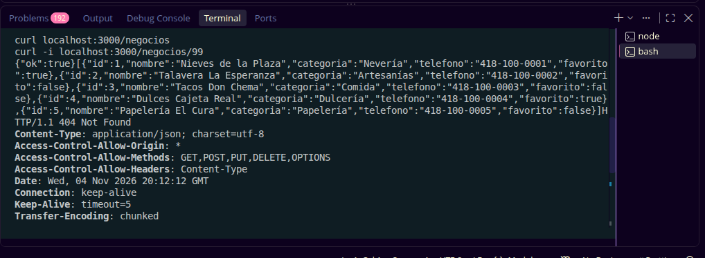

### Ronda 2 · El modelo Negocio
#### Rojo
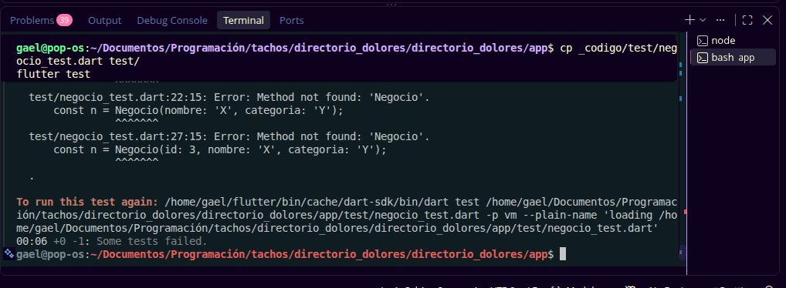
#### Verde
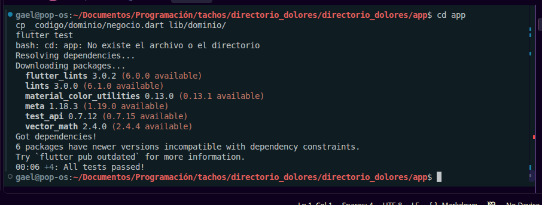

### Ronda 3 · El cliente HTTP con MockClient
#### Rojo
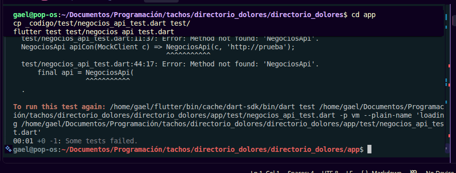
#### Verde
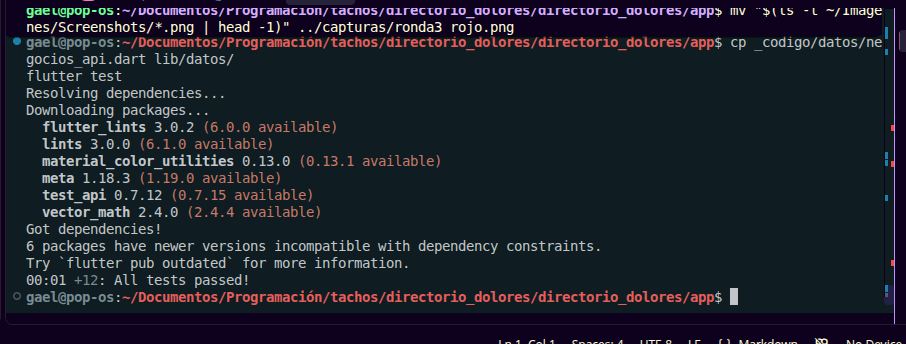

### Ronda 4 · Conectar app y API
#### Manifiesto de Android
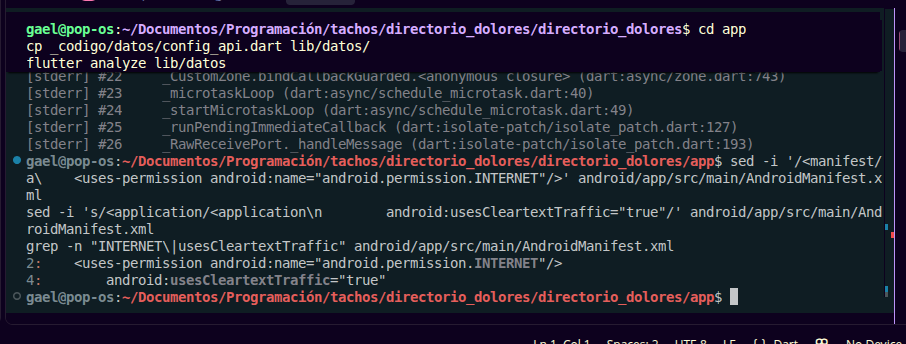
#### API alcanzable por IP
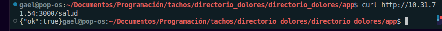

### Ronda 5 · El ViewModel y los 5 estados
#### Rojo
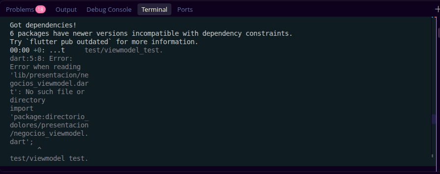
#### Verde
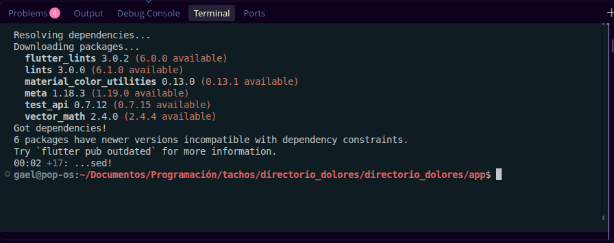

### Ronda 6 · La pantalla y la prueba final
#### Análisis y pruebas

#### Lista cargada
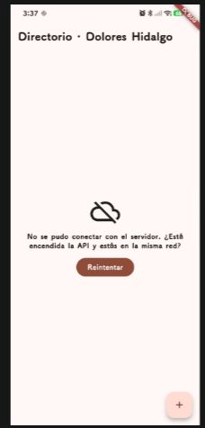
#### Marcar favorito
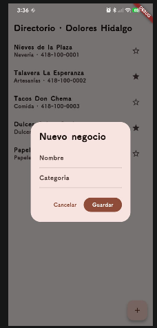
#### Agregar negocio
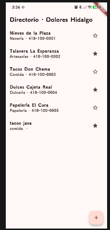
#### Error y reintentar
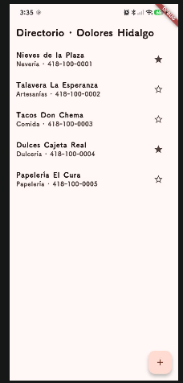
